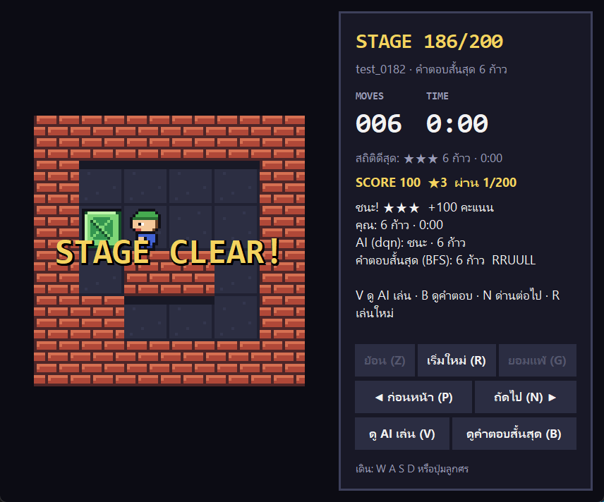
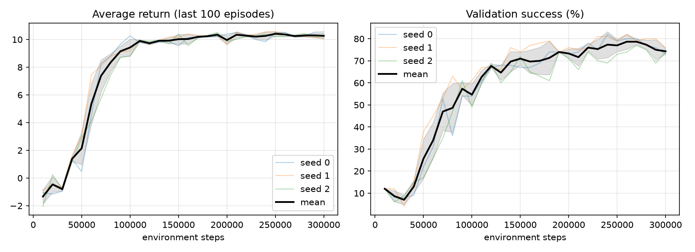
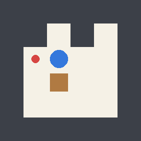
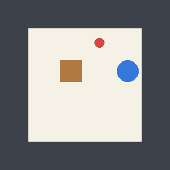
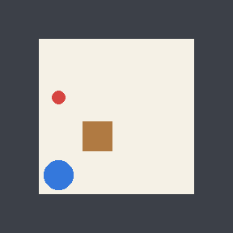

# Sokoban-RL

An AI that teaches itself to play Sokoban with reinforcement learning. The game, level
generator and BFS solver are written from scratch (NumPy); the agents are a tabular
**Q-Learning** agent (stage 1) and a small-CNN **DQN** in PyTorch (stages 2–3).
BFS provides the optimal answer that the AI is compared against.

| Stage | Levels | Algorithm | Pass criterion |
|---|---|---|---|
| 1 | one fixed 6×6 level, 1 box | Q-Learning (table) | solves it with the BFS-optimal number of steps |
| 2 | random 6×6 levels, 1 box | DQN | ≥ 80 % solved on the validation set |
| 3 (optional) | random 7×7 levels, 2 boxes | DQN, warm-started from stage 2 | ≥ 50 % on validation |

Full design notes and the step-by-step build plan are in [PLAN.md](PLAN.md).

## Install

```bash
python -m venv .venv && .venv\Scripts\activate      # Windows (use source .venv/bin/activate elsewhere)
pip install -e ".[dev]"
pytest
```

## Run

All commands are run from the repository root.

```bash
# Stage 1: Q-Learning on the example level (expect: URD, 3 steps, matches BFS)
sokoban-rl q-learn --level data/example.txt --seeds 0 1 2

# Stage 2: generate 1,000 / 100 / 200 train / val / test levels, then train 3 seeds
sokoban-rl make-levels --stage 2
sokoban-rl train --stage 2 --seed 0 --steps 20000      # quick smoke test first
sokoban-rl train --stage 2 --seed 0                    # full run (also --seed 1, --seed 2)
sokoban-rl plot models/s2_seed0/log.csv models/s2_seed1/log.csv models/s2_seed2/log.csv

# In a second terminal while training runs: progress bar, percent, time left (Ctrl+C stops watching only)
sokoban-rl watch                                       # every unfinished run
sokoban-rl watch models_double/s2_seed2                # one specific run

# Final numbers: Random vs DQN (best.pt of each seed) vs BFS on val and test
sokoban-rl evaluate --stage 2 --splits val test --agents random bfs dqn --seeds 0 1 2

# Demo: AI solves one level (terminal animation + GIF)
sokoban-rl play --file data/example.txt --agent qtable --gif results/example.gif
sokoban-rl play --split test --idx 5 --agent dqn --gif results/test5.gif
sokoban-rl play --file my_level.txt --agent dqn        # draw your own 6x6 level

# Graphical game (retro pixel-art window): level after level, score, timer, saved progress
sokoban-rl gui                                         # starts in easy mode at your first unsolved stage
sokoban-rl gui --difficulty hard                       # easy | medium | hard
sokoban-rl gui --level 150 --model models_double/s2_seed2/best.pt
sokoban-rl gui --file my_level.txt

# Challenge: you play first, then the AI plays the same level and both are compared with BFS
sokoban-rl challenge                                   # random test level
sokoban-rl challenge --split test --idx 11             # a specific level (replay one you lost)
sokoban-rl challenge --file my_level.txt --agent qtable
```



In `challenge`, move with **W A S D** or the arrow keys, **Z** undoes, **R** restarts, **G** gives
up (asks to confirm, then shows the AI's answer), **Q** quits. When you win or give up it shows
your moves, the AI's moves and the shortest BFS answer side by side. Bumping into a wall is
not counted as a move for you, but it is counted for the AI, which is how its stuck-on-a-wall
failures show up.

`python -m sokoban_rl ...` works too. Training flags: `--double` (Double DQN),
`--init <weights>` (warm start), `--threads N`, `--eval-every N`; see `sokoban-rl train -h`.

Level symbols: `#` wall · `@` player · `+` player on target · `$` box · `.` target · `*` box on target.
Actions: `U D L R`; the example level is solved by `URD`.

## Layout

```
src/sokoban_rl/
  game.py        rules, level parsing, observation tensor, SokobanEnv
  solver.py      BFS oracle (shares move() with the game)
  levelgen.py    reverse-play level generator, rotation-aware de-duplication
  qlearning.py   stage 1
  dqn.py         stages 2-3: network, replay buffer, training loop
  policies.py    random / BFS / Q-table policies
  evaluation.py  success %, steps vs BFS, deadlock %
  human.py       play a level yourself and compare with the AI (`challenge`)
  gui.py         graphical game window (`gui`, tkinter)
  sprites.py     original 16x16 pixel-art tiles drawn in code
  campaign.py    level order, score, stars, timer results, saved progress
  deadlock.py    dead squares + frozen boxes (warnings in the human games)
  monitor.py     live progress bar for a running training (`watch`)
  render.py      terminal animation + GIF
  plotting.py    training curves
  cli.py         the `sokoban-rl` command
tests/           pytest suite
data/            example.txt (tracked); generated s{2,3}_{train,val,test}.json (git-ignored)
models/ results/ generated artifacts (git-ignored)
```

## Design notes

- **Rewards:** −0.1 per step, +1 box onto a target, −1 box off a target, +10 win,
  −5 and end on a corner deadlock.
- **Terminal vs time limit:** win/deadlock are terminal; the 50-step limit is a
  *truncation*, so the Q target still bootstraps there.
- **No leakage:** train/val/test use different seeds and are de-duplicated up to
  rotation and reflection (8 symmetries). The test split is for the final report only.
- **Observation:** 4 planes (wall, player, box, target) padded to 7×7, so the same
  network works for 6×6 and 7×7 levels.
- **Deadlocks:** the RL environment ends an episode only on a corner deadlock, and all results
  use that rule. The human games use the stronger `deadlock.py` (boxes on dead squares along a
  wall, frozen pairs and 2x2 blocks) to warn you early; a test checks it never flags a solvable state.
- **Difficulty in `gui`** (keys 1-3): three modes of 20 stages, one box, one floor size each:
  easy = 3x3 floor (5x5 board with walls), medium = 4x4 (6x6), hard = 5x5 (7x7). Within a mode
  the shortest solution grows stage by stage (ties: more pushes = harder). Stages are picked
  from a large generated pool and none is shaped like a level the AI trains or is tested on.
  Sets are cached in `data/play_*.json`. Modes with 2 and 3 boxes exist but are hidden for now
  (`--difficulty two_boxes` / `expert`).
- **Stage 5 (mixed board sizes, not used by default):** one box on 5x5, 6x6 and 7x7 boards
  (10 % / 45 % / 45 % of each split, because the 3x3 floor has only ~180 distinct levels), trained
  300k steps from the seed 2 Double DQN model. Test success 47.5 % (random 31.5 %). It is better
  than the stage 2 model only on the 5x5 floor (41 % vs 31 %) and clearly worse on 3x3 and 4x4
  (50 % vs 70 %, 53 % vs 89 %), so the game keeps using the stage 2 model; try stage 5 with
  `--model models/s5_seed0/best.pt`. A follow-up stage 6 run (7x7 board only, warm-started from stage 5,
  300k steps) failed: validation peaked at 24 % after 50k steps, then fell to 7-9 % while the training
  return turned negative, and its final test success (14.5 %) is below random (18.5 %). Not used. A 2-box run (stage 3) stayed at 1-4 % validation, below
  random (14 %), so it was stopped; stages 3 and 4 can still be generated with `make-levels`.
- **Scoring in `gui`:** 100 × shortest ÷ your moves per level (100 = optimal, 0 = gave up);
  stars 3 / 2 / 1 for optimal / ≤ 1.5× / solved. Best results are saved in `results/progress_*.json`.
- **Known limits:** small maps only; the greedy DQN can get stuck repeating a move (see Results).

## Results

### Stage 1 — Q-Learning on the example level
All 3 seeds learn `URD` (3 steps, identical to BFS) in about 0.5 s each, from ~140 visited states.

### Stage 2 — DQN on random 6×6 levels (1 box)
`best.pt` of each seed (selected on validation), greedy play (ε = 0), mean ± std over seeds 0, 1, 2.
Random is also averaged over 3 seeds.

| Agent | Train (1,000) | Validation (100) | **Test (200)** | Steps ÷ BFS | Deadlock |
|---|---|---|---|---|---|
| Random | 22.8 ± 1.3 % | 23.3 ± 4.2 % | 27.2 ± 3.4 % | 5.85 | 26.2 % |
| **DQN** | 96.6 ± 0.0 % | 80.3 ± 2.4 % | **75.8 ± 3.2 %** | 1.01 | 0.0 % |
| BFS (optimal) | 100 % | 100 % | 100 % | 1.00 | 0 % |

Per-seed best validation: 82 %, 82 %, 77 %, so 2 of 3 seeds pass the ≥ 80 % stage 2 criterion.

**Extra run: seed 2 retrained with Double DQN.** Seed 2 missed the criterion, so it was trained
again with Double DQN targets, 500k steps and ε decaying over 150k steps (`models_double/`).
This is one extra run, decided on validation only, and it changes two things at once (algorithm
and length), so it does not show which of them helped. The table above is left as it was.

| Seed 2 | Train | Validation | Test | Steps ÷ BFS | Deadlock |
|---|---|---|---|---|---|
| DQN, 300k steps (in the table above) | 96.7 % | 77.0 % | 71.5 % | 1.01 | 0.0 % |
| Double DQN, 500k steps | 97.2 % | **82.0 %** | **81.0 %** | 1.01 | 0.0 % |

With it, all 3 seeds reach ≥ 80 % validation. Training took 88 min alone on CPU (8 threads).
Training time: ~93 min per seed for 300k steps, 3 seeds in parallel on CPU (4 threads each);
the plan's 15–30 min estimate was too optimistic.



**What the numbers say**

- **It learned to play, far above random:** 76 % on unseen test levels vs 27 % for random.
  When it solves a level it is almost always optimal (1.01 × BFS) and it never pushes a box
  into a corner.
- **It partly memorises the training levels:** 97 % on train vs 80 % validation / 76 % test.
  Validation is slightly optimistic because `best.pt` was chosen on it; test is the honest number.
- **Harder levels fail more:** on the test set (seed 0), success is 82 % for 3-step levels but
  only 25 % for 7-step levels.
- **Main failure mode is a loop, not a bad push:** of 59 validation failures across the
  3 seeds, 50 are the agent repeating one move into a wall and 9 are a two-move
  back-and-forth. Because a wall bump leaves the board unchanged, a deterministic greedy
  policy repeats the same choice until the 50-step limit.

**Post-hoc: skipping moves that change nothing.** The loop failure above comes from the network
rating a wall bump as good as (or better than) the best real move: the true difference is only
about 0.1-0.2 points, smaller than its error. Forbidding moves that leave the board unchanged at
play time (`--mask`, no retraining) lifts the same three `best.pt` files:

| Seeds 0, 1, 2 (original runs) | Validation | Test (200) |
|---|---|---|
| Greedy, as in the table above | 80.3 ± 2.4 % | 75.8 ± 3.2 % |
| Greedy, wasted moves forbidden (`--mask`) | 89.7 ± 1.7 % | 89.2 ± 0.2 % |

The idea came from looking at the validation failures, so treat the validation gain as optimistic;
the test set was evaluated once, after the idea was fixed. The table above is unchanged and is
still the plain greedy result. `play`, `challenge` and `evaluate` take `--mask`; the `gui` game
uses it by default (`--no-mask` turns it off). `train --mask` also removes such moves from
exploration and from the Q target (max over real moves only).

| Optimal win (test #12, 6 steps) | Win with detour (test #14, 11 vs 7) | Loss: stuck on a wall (test #11) |
|---|---|---|
|  |  |  |
